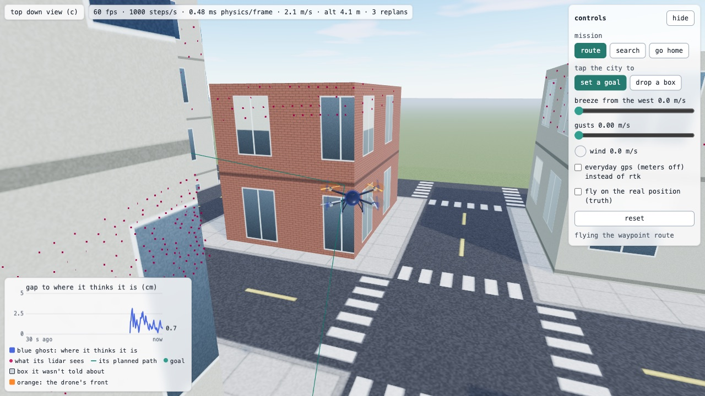
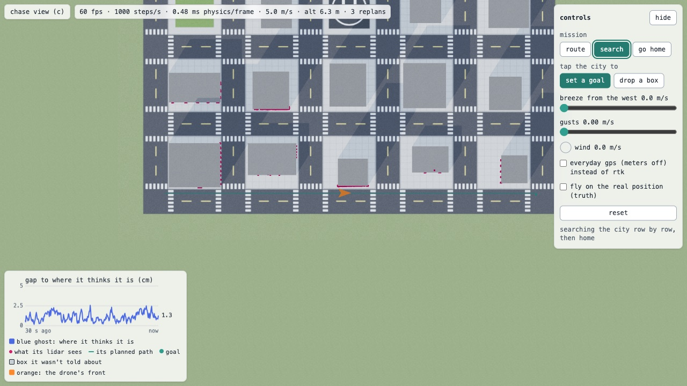

# drone-sim

An autonomous quadcopter simulator that runs in the browser. The drone has real flight physics, plans its own path through a city of boxes, follows it with a cascaded PID flight controller, sees obstacles with a simulated lidar and works out where it is from noisy sensors. You can tap to give it a goal, drop boxes in its way, turn on wind, or send it on a preset mission: a waypoint route, a lawnmower search of the whole city, or back home.

Try it live: https://joshuacortes195.github.io/drone-sim/





The physics, control, planning and estimation are written in C++ and tested natively. The same code is compiled to WebAssembly for the browser, where three.js draws the scene.

Status: phases 0 to 6 are done, and most of phase 7: the batch evaluation, the UI pass and the deploy. Still to do are gifs for this page and a rerun of the evaluation on my PC (the numbers below are from my Intel Mac).

## Numbers

Over 1000 seeded cities with a random trip in each, flying the whole stack (planning, the RTK estimate, the lidar and replanning), every flight reached its goal, in calm air and in a 4 m/s breeze with 1.5 m/s gusts ([results/eval.md](results/eval.md)).

| | calm | windy |
|---|---|---|
| success (within 1 m of the goal, no crash, inside 120 s) | 1000 / 1000 | 1000 / 1000 |
| tracking error, rms per flight, median | 0.104 m | 0.142 m |
| estimation error, rms per flight, median | 0.013 m | 0.013 m |
| off the goal at the end, median | 0.078 m | 0.095 m |
| planning time (A* + smoothing), median | 10.4 ms | |
| path length / straight line, median | 1.009 | |

The first run had one crash in the wind, on a short downwind leg ending next to a building. The controller only asked for 34° of tilt, but the drone tipped to 53°: braking near full thrust, the mixer kept the total thrust exact and could only give the attitude loop about a fifth of the torque it needed. Now roll and pitch come before thrust in the mixer, the tilt peaks at 35.5° on that trip, and all 1000 make it. The rest of the numbers, from the physics up, are in [results/](results/).

The physics is 6 degrees of freedom with quaternions, a four motor mixer, motor lag and rotor drag, stepped with RK4 at 1 ms. The controller is a cascaded PID (rate, attitude, velocity, position) with an inverse mixer that gives up yaw first when the rotors saturate, then thrust, and keeps roll and pitch. It settles 1 m steps in under 1.9 s with under 2% overshoot and follows a ramped 5 m/s route with 0.114 m RMS error ([results/control.md](results/control.md)). In the browser it held 60 fps on my Intel Mac (i5-8259U) with the physics on a fixed 1 ms step ([results/browser.md](results/browser.md)).

For planning, a seed builds a city of buildings, and 26 neighbor A* searches a 0.5 m voxel grid with the buildings grown by the drone's size, then line of sight smoothing cuts the path down. Across 200 random trips the smoothed path is 0.5% longer than a straight line at the median and takes 7.6 ms to plan in the browser. Flying each one, the worst tracking error is 0.91 m (a hard turn where the mixer traded some height for attitude) and the drone's center never gets closer than 0.67 m to a building ([results/planning.md](results/planning.md)).

The drone works out where it is from simulated sensors with noise from real data sheets, using a Kalman filter for position and a complementary filter for attitude. With an RTK GPS the estimate is 1.1 cm RMS off and the planned flights are as safe as flying on the truth. A regular GPS puts 51 of 200 flights within reach of a building ([results/estimation.md](results/estimation.md)).

It also has a simulated lidar (the Velodyne VLP-16 beam pattern) and replans when it sees something new. I dropped an unknown cube on each of 200 planned paths: flying blind hit it every time, and with the lidar every flight got around it and reached the goal ([results/lidar.md](results/lidar.md)).

Wind is a steady breeze plus gusts, and it pushes on the drone through rotor drag. In an 8 m/s breeze it leans 6.5 degrees into the wind and holds its spot within 0.3 mm. In 3 m/s gusts on RTK it wanders 0.15 m RMS and gets pushed at most 0.42 m. With a regular GPS it wanders about 1.25 m whatever the wind, so the GPS matters more than the wind ([results/wind.md](results/wind.md)).

In the page the drone flies on its own estimate, with a see-through blue ghost where it thinks it is, a live plot of how far off that is, and the lidar hits as dots. The full plan is in [docs/plan.md](docs/plan.md), and my notes on the physics and controls are in [docs/robotics-notes.md](docs/robotics-notes.md).

## Build and test

You'll need CMake 3.20+ and a C++17 compiler (I've built it with Apple clang on macOS and MSVC on Windows).

```bash
cmake -S . -B build
cmake --build build
ctest --test-dir build --output-on-failure
```

On Windows I build with the Visual Studio 2022 Build Tools. From an "x64 Native Tools Command Prompt" (or after running `vcvars64.bat`), the same commands work with Ninja, and the programs end in `.exe`:

```bat
cmake -S . -B build -G Ninja
cmake --build build
ctest --test-dir build --output-on-failure
```

To print the physics numbers in [results/physics.md](results/physics.md) (free fall error, RK4 vs Euler drift, cost per step):

```bash
./build/physics_report
```

To print the control numbers in [results/control.md](results/control.md) (step responses, route tracking error, cost per controller call):

```bash
./build/fly_route
```

To print the planning numbers in [results/planning.md](results/planning.md) (planning time, path length, and how each planned path flies):

```bash
./build/plan_report
```

To print the lidar numbers in [results/lidar.md](results/lidar.md) (200 flights past an unknown cube, blind and with the lidar, about 30 s):

```bash
./build/lidar_report
```

To print the wind numbers in [results/wind.md](results/wind.md) (540 hovers in breezes and gusts on the truth, RTK and a regular GPS, about 90 s):

```bash
./build/wind_report
```

To run the batch evaluation in [results/eval.md](results/eval.md) (a random trip over each of 1000 seeded cities, calm and windy, about 4 minutes on my Mac). Pass a smaller count to try it quickly:

```bash
./build/batch_eval 1000
```

## Run it in the browser

Every push to main runs the C++ tests and builds the page on GitHub Actions, then puts it on GitHub Pages (`.github/workflows/deploy.yml`). To run it yourself you'll need Node 22+. The compiled wasm is checked in, so this works without Emscripten:

```bash
cd web
npm install
npm run dev
```

The drone flies a loop of planned paths through a seeded city, with the planned path drawn in teal. The blue ghost is where the drone thinks it is, the magenta dots are the last lidar turn, and the outlined cube is one it wasn't told about. It drops onto the first leg once the drone is moving, so you can watch the lidar find it and the path get redrawn, with the old path faded for 2 s. The plot in the corner is how far the estimate is from the real drone, averaged over each 0.1 s. Press `c` or the button to switch between the chase camera and the map view.

The scene is lit like a real place: a physical sky that also lights everything through an environment map, a sun with soft shadows over the whole city, streets with lane lines and crosswalks, a landing pad at home, and buildings in glass, concrete and brick whose windows pick up the sky. The drone has carbon arms, metal motors, landing legs and a GPS mast. Its props really turn, at a slowed down rate because the real 660 rad/s hover speed would just flicker on a 60 Hz screen, and they fade into a blur disc as the motors speed up. With all of that it still held 60 fps on my Intel Mac ([results/browser.md](results/browser.md)).

The mission buttons pick what it flies. Route is the loop above. Search is a lawnmower pattern: rows back and forth over the whole flying area at 6 m, spaced so they run along the east west streets, and then it comes home. Go home climbs to 6 m if it's lower, flies back over the pad, comes down and lands, and the motors stop once the skids touch. Each leg still goes through A*, so a box you drop in the way gets planned around.

The panel on the side lets you tap the city to set a goal (it stops the tour until you reset) or drop a 2 m box the drone doesn't know about, set a breeze from the west and gusts, switch to a regular GPS and fly on the real position instead of the estimate. If the drone hits something it stops and a banner offers a reset. Frame rate and physics numbers are in [results/browser.md](results/browser.md).

To rebuild the wasm after changing the C++ (needs [Emscripten](https://emscripten.org)):

```bash
emcmake cmake -S . -B build-wasm
cmake --build build-wasm
```

On Windows add `-G Ninja` to the first line.

That writes `web/src/wasm/drone.js` and `drone.wasm`.
